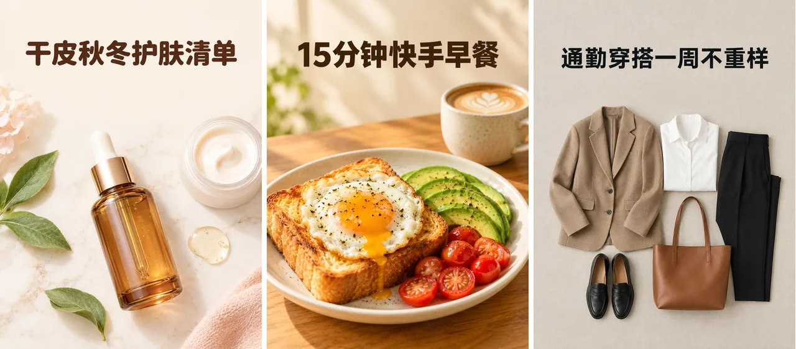

# 小红书封面制作 Skill

简体中文 | [English](./README.en.md) | [日本語](./README.ja.md)

> 👉 也看看 [小红书文案 Skill](https://github.com/beatra-ai/xiaohongshu-copywriter-skill)

把一张照片或一个选题想法做成竖版 3:4 小红书封面，背景干净、焦点突出、预留文字区域，适配美妆、美食、穿搭和生活图文，在 Claude Code、Cursor、Codex、Windsurf、Cline 或 OpenClaw 里直接完成。

> [!IMPORTANT]
> 生成需要 [Beatra](https://beatra.ai?utm_source=github&utm_medium=flagship&utm_campaign=xiaohongshu-cover-maker-skill) 账号并消耗积分，安装本身不收费。

| 问题 | 回答 |
| --- | --- |
| **能做什么** | 将一张照片或一个选题想法转化为高点击率的竖版 3:4 小红书封面，搭配干净背景、突出焦点构图和预留文字区域，适配美妆、美食、穿搭和生活图文。 |
| **底层模型** | Qwen Image 2.0 Fast、Qwen Image 3.0、Qwen Image 3.0 Pro、Wan Image 2.7 Fast、Qwen Image 2.0 Pro、Wan Image 2.7 Pro、GPT Image 2.5 Flare、GPT Image 2.5 Sunburst、GPT Image 2、MiniMax Image 01 Live |
| **运行要求** | Python 3.10+，以及能加载 `SKILL.md` 的 Agent |
| **费用** | 安装免费。每次生成消耗 Beatra 账号积分，只有你明确要求这次生成或批准确认卡后才会付费。 |
| **支持的 Agent** | Claude Code、Cursor、Codex、Windsurf、Cline、OpenClaw |

<p align="center"></p>

*根据选题生成的三张竖版 3:4 小红书笔记封面：无品牌精华瓶护肤平铺图配标题「干皮秋冬护肤清单」、煎蛋吐司配牛油果和小番茄的家常早餐配标题「15分钟快手早餐」，以及无模特的通勤服装平铺图配标题「通勤穿搭一周不重样」。由 Beatra AI 生成。*

| Skill | Entry point | Version |
| --- | --- | --- |
| [`zhongcao-cover-maker`](skills/zhongcao-cover-maker) | [SKILL.md](skills/zhongcao-cover-maker/SKILL.md) | 0.2.9 |

本仓库由 [beatra-ai/beatra-skills](https://github.com/beatra-ai/beatra-skills/tree/main/skills/zhongcao-cover-maker) 自动发布，问题请到那里反馈。

## 安装

使用 [`skills`](https://skills.sh) CLI：

```bash
npx skills add beatra-ai/xiaohongshu-cover-maker-skill
```

使用 GitHub CLI：

```bash
gh skill install beatra-ai/xiaohongshu-cover-maker-skill zhongcao-cover-maker
```

也可以克隆本仓库，把 `skills/zhongcao-cover-maker` 复制到 `~/.claude/skills/`（Claude Code）、`~/.cursor/skills/`（Cursor）、`~/.agents/skills/`（Codex）、`~/.codeium/windsurf/skills/`（Windsurf）、`~/.cline/skills/`（Cline）或 `~/.openclaw/skills/`（OpenClaw）。

或者把下面这段话发给你的 Agent：

```text
从 https://github.com/beatra-ai/xiaohongshu-cover-maker-skill 安装 zhongcao-cover-maker skill（目录 skills/zhongcao-cover-maker），然后按它的 SKILL.md 连接我的 Beatra 账号。
```

## 技术规格与输出限制

截至 2026-10-18。实时列表：https://docs.beatra.ai/zh/docs/models

- **上传** — 单个文件最大 100 MB；同时适用下方各模型的输入限制
- **图生图** — 10 个模型（Qwen Image 2.0 Fast、Qwen Image 3.0、Qwen Image 3.0 Pro、Wan Image 2.7 Fast、Qwen Image 2.0 Pro、Wan Image 2.7 Pro、GPT Image 2.5 Flare、GPT Image 2.5 Sunburst、GPT Image 2、MiniMax Image 01 Live）；PNG；单次最多 4 张；画布最大 16.8 MP
  - 16.8 MP（4K 档）：GPT Image 2.5 Flare、GPT Image 2.5 Sunburst、GPT Image 2（单次 1 张）
  - 输入图片：单次最多 4 张，每张 10–20 MB；BMP、GIF、JPEG、PNG、TIFF、WEBP
- **文生图** — 10 个模型（Qwen Image 2.0 Fast、Qwen Image 3.0、Qwen Image 3.0 Pro、GPT Image 2.5 Flare、GPT Image 2.5 Sunburst、GPT Image 2、Wan Image 2.7 Fast、Qwen Image 2.0 Pro、Wan Image 2.7 Pro、MiniMax Image 01 Live）；PNG；单次最多 4 张；画布最大 16.8 MP
  - 16.8 MP（4K 档）：Wan Image 2.7 Pro（单次最多 4 张）；GPT Image 2.5 Flare、GPT Image 2.5 Sunburst、GPT Image 2（单次 1 张）
- **图片编辑** — 6 个模型（Qwen Image 2.0 Fast、Qwen Image 3.0、Qwen Image 3.0 Pro、Wan Image 2.7 Fast、Qwen Image 2.0 Pro、Wan Image 2.7 Pro）；PNG；单次最多 4 张；画布最大 4.2 MP
  - 4.2 MP（2K 档）：Qwen Image 2.0 Fast、Qwen Image 3.0、Qwen Image 3.0 Pro、Wan Image 2.7 Fast、Qwen Image 2.0 Pro、Wan Image 2.7 Pro（单次最多 4 张）
  - 输入图片：单次最多 4 张，每张 10–20 MB；BMP、GIF、JPEG、PNG、TIFF、WEBP

## 为什么用 Beatra，而不是直接调用模型 API

- **一个账号用到本 skill 的全部模型** — 图生图 10；文生图 10；图片编辑 6（Qwen Image 2.0 Fast、Qwen Image 3.0、Qwen Image 3.0 Pro、Wan Image 2.7 Fast、Qwen Image 2.0 Pro、Wan Image 2.7 Pro、GPT Image 2.5 Flare、GPT Image 2.5 Sunburst、GPT Image 2、MiniMax Image 01 Live）（截至 2026-10-18），一次 Beatra 登录即可使用，不必分别管理各家模型的 key。
- **花不花钱由你决定** — 只有你明确要求这次生成，或批准显示实时积分估算的确认卡后才会付费。
- **先策划，再生成** — skill 先帮你规划、指导和检查，再在 Beatra 上生成。
- **文件可以核验** — `skills/` 下的每个文件都与 cdn.beatra.ai 上的发布归档逐字节一致，每次推送前用 SHA-256 校验。
- **更新由你掌控** — 不含自更新程序；用安装时的工具更新。
- **在你的 Agent 里运行** — Claude Code、Cursor、Codex、Windsurf、Cline、OpenClaw。

## 你能得到什么

- **为信息流而生** — 竖版 3:4 封面在小红书双列瀑布流中占据更大的展示空间，更容易被看到。
- **预留文字区域** — 每张封面都预留干净的文字区域——上部三分之一、居中或底部——让你的大标题花字完美落地，不与画面冲突。
- **按品类匹配风格** — 美妆封面明亮通透，美食封面温暖诱人，穿搭封面杂志极简。封面风格自动匹配你的内容品类。

## 适用场景

- **美妆护肤封面** — 明亮干净的柔焦背景，搭配柔和色调和自然肤质——适合产品测评、教程和护肤分享。
- **美食探店封面** — 温暖诱人的美食摄影，浅景深、自然窗光，菜品作为绝对主角充满画面。
- **穿搭 OOTD 封面** — 杂志感构图，全身或半身人像，干净都市或影棚背景，服装与环境色彩协调。
- **知识科普封面** — 干净扁平化布局，高对比度，信息图友好构图，留出充足空间放置大标题。

## 常见问题

### 能用我的美食照片做封面吗？

可以。上传美食照片，工具会将其转化为温暖诱人的竖版封面，搭配浅景深、自然光效和菜品作为主角。

### 没有照片也能生成封面吗？

可以。描述你的笔记选题和风格方向，工具会从描述生成封面概念，搭配竖版 3:4 画布和预留文字区域。

### 封面会留出放标题文字的位置吗？

会的。每张封面都预留干净的文字区域——上部三分之一、居中或底部——让你放置大标题花字时不与画面冲突。

### 能修复已认可封面的某个区域吗？

可以。上传已认可的封面，描述需要修复的地方——干扰物体、色温或瑕疵——编辑只针对该区域，不改变其他部分。

## 更新与安全

自 2026 年 10 月的版本起，本 skill 不再包含自更新程序：它只运行你安装的文件，从不自行替换。
请用安装时的工具更新——`npx skills update zhongcao-cover-maker` 或 `gh skill update zhongcao-cover-maker`。
详见 skill 内的 `references/updates-and-security.md`。

## 许可证

[MIT-0](LICENSE)：可自由使用、修改和再分发，包括商用，无需署名；与这些 skill 在 ClawHub 上的条款一致。

## 相关链接

- 官网 — https://www.beatra.cn?utm_source=github&utm_medium=flagship&utm_campaign=xiaohongshu-cover-maker-skill
- 文档 — https://docs.beatra.cn?utm_source=github&utm_medium=flagship&utm_campaign=xiaohongshu-cover-maker-skill
- 控制台 — https://console.beatra.cn
- 给 AI Agent 读的说明 — https://www.beatra.cn/llms.txt （索引）· https://www.beatra.cn/llms-full.txt （全部 skill 合成一个文件）

- 微信小程序 — 国内用户微信扫码使用


